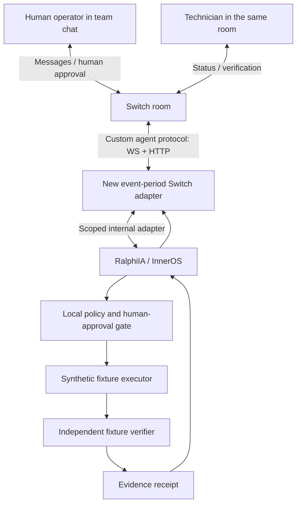

# Architecture and trust boundaries

## Planned competition architecture (not implemented)

There is **no** `A` implementation yet. The dashed future link to real infrastructure is intentionally excluded until separate customer authorization and real E2E validation.

## Existing reusable prep package

`Incident -> propose_actions -> enforce_policy -> execute_fixture -> receipt` operates on an in-memory, explicitly synthetic dictionary. It has no sockets, physical-device drivers, credential loading, persistence or remote access. The receipt uses canonical JSON and SHA-256 to flag change; **it is not signed and not sufficient for legal or security-grade nonrepudiation**.

## Requirements for event implementation

- Use Switch itself as a *central* collaboration layer. No chat-side simulation claiming to be Switch.
- Live messages and human approvals must occur in a connected Switch room.
- Persist message correlation IDs, who requested, who approved, action ID and independent verification.
- Separate identities for chat user, agent and target system; do not trust free-form approval text without verified identity.
- No privileged mutation executor in public demo; fixture simulator only.
- Fail closed when Switch goes offline, approval expires, a replay is detected or a task is outside its scope.
- Local model routing by default; cloud inference is an optional documented fallback, not a requirement.
- Enable reviewer self-service: clone, install, run tests, join room, demonstrate approval and denial.

## Threats

Prompt injection from chat messages, forged mentions, identity confusion, repeated approval requests, room cross-contamination, secret leakage, live-network accidents, failed or fraudulent verification, stale worker locks. The competition adapter must treat every inbound message as untrusted until scoped to an authenticated Switch actor and authorized room.
